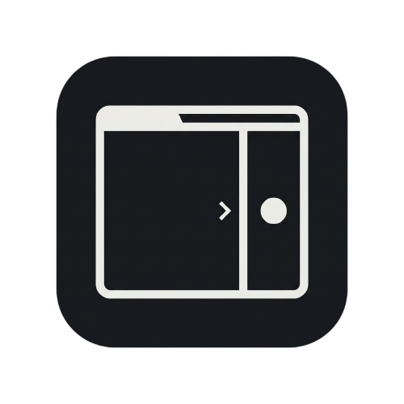

<p align="center"></p>

# Sidespace

A Chrome extension that opens any website as tabs in Chrome's side panel: a second, narrow browser next to the page you are reading, with an app rail, bookmarks, notes and a dashboard.

## Features

- **Any site in the side panel**, including sites that normally refuse to be embedded (see [How embedding works](#how-embedding-works)).
- **App rail**: a dock on the panel edge with pinned web apps. ChatGPT, Gemini, Claude and Perplexity are pinned by default. Add any site with the **+** under the apps, right-click an app to edit, move or remove it, or drag it to reorder; the settings page has the same editor. Each app keeps its own panel tab, so switching back is instant. Rail on the left, right, or hidden.
- **Panel tabs**: open tabs sit in the rail under the apps (or only in the tab list, if you prefer); the tab count button in the toolbar lists every tab with its full title. Drag to reorder, middle-click or hover **×** to close.
- **Navigation**: address bar that takes a URL or a search, back, forward, reload. Each tab has its own history; the address bar follows link clicks and single-page-app navigation.
- **Dashboard**: the new tab page shows a clock, a search box, and your speed dial shortcuts.
- **Bookmarks**: browse folders and search your Chrome bookmarks inside the panel, and bookmark the panel page. Chrome asks for bookmark access the first time.
- **Quick notes**: a notepad in the panel, saved automatically on this device.
- **Mobile view**: ask chosen sites (or all sites) for their mobile version, which suits the narrow panel.
- **Per-tab zoom**.
- **Ways in**: toolbar icon, `Alt+Shift+S`, right-click "Open link / this page in Sidespace", "Search Sidespace for …", `Alt+Shift+D` to move the current page into the panel, and "Load current browser tab here" in the panel menu. "Open in browser tab" goes the other way.
- **New-window links** (`target=_blank`, including via `<base>`) and `window.open(url, '_blank', 'noopener')` calls made while you are using the page (a click or key press in the last few seconds) become new panel tabs, or browser tabs if you prefer.
- **Session restore**: panel tabs and their history come back when you reopen the panel, and after restarting Chrome. Restored tabs load only when you switch to them.
- **Look**: a dark theme in the [Vesper](https://github.com/vladzima/vesper-theme) palette and a matching light theme, one consistent font scale, real site icons where Chrome has them, and an address bar that shows `example.com/path` until you click it.
- **Customisation**: theme (system, light, dark), accent colour (theme default or a swatch), density, rail position, where open tabs show, clock, search engine (Google, DuckDuckGo, Bing, Brave, or a custom `%s` template), home page, rail apps and speed dial (add, edit, reorder, remove), settings export and import.

### Keyboard (inside the panel)

| Keys | Action |
| --- | --- |
| `Alt+L` | Focus the address bar |
| `Alt+T` / `Alt+W` | New tab / close tab |
| `Alt+R` | Reload |
| `Alt+←` / `Alt+→` | Back / forward |
| `Alt+1` … `Alt+8`, `Alt+9` | Go to tab 1 to 8, last tab |

These also work while a web page in the panel has focus, except inside text fields.

## Install (unpacked)

1. Download `sidespace-<version>.zip` from the [latest release](https://github.com/monarchmaisuriya/sidespace/releases/latest) and unzip it, or clone this repository.
2. Open `chrome://extensions`, turn on **Developer mode**.
3. Click **Load unpacked** and pick the unzipped (or cloned) folder.
4. Click the Sidespace icon (pin it from the puzzle menu) or press `Alt+Shift+S`.

Requires Chrome 128 or newer.

## Signing in

The panel uses your normal Chrome sign-ins: sites in the panel get the same cookies and site storage as your tabs. If you are signed in to a site in a tab, you are signed in to it in the panel.

- Sign-in pages that refuse to load in a frame (Google's, for one: Google blocks sign-in inside embedded frames) can be done in a normal tab. Sign in there, then reload the panel tab.
- Sign-in popups ("Sign in with …" windows) open as real popups, so they can hand the result back to the page that opened them.

## How embedding works

The side panel can only show extension pages, so Sidespace shows each website in an `<iframe>` inside its panel page.

Many sites forbid being framed with `X-Frame-Options` or a `Content-Security-Policy` containing `frame-ancestors`. With **Show them anyway** on (the default), Sidespace removes those headers with `declarativeNetRequest` session rules, scoped as tightly as Chrome allows:

```
request for a frame
  |
  +-- in a normal browser tab? ----------------------------> never touched
  |
  +-- in the side panel (no tab), and either
  |     - the panel itself started the load, or
  |     - it is same-site as the frame that started it ----> headers removed
  |
  +-- anything else, e.g. a page in the panel embedding
        a different site --------------------------------> headers kept (blocked)
```

- A page shown in the panel cannot embed another site with that site's clickjacking protection removed, not even through a redirect.
- When a page in the panel follows a link to a different site, Sidespace cancels that navigation and loads the link itself, so the new site is unlocked as the panel page (and the address bar shows it), never as a hidden embed.
- Cross-site form POSTs inside the panel are not rerouted; if the target forbids framing, the panel offers "Open in a browser tab".
- A `Content-Security-Policy` header is removed only when it contains `frame-ancestors`. For those pages, while shown in the panel, the site's other CSP protections are also gone. Turn the setting off if that matters to you.

Other safeguards:

- Frames are sandboxed without `allow-top-navigation`, so a page cannot replace the panel.
- The address bar origin always comes from the browser. A page can change its path with `history.pushState`, but it cannot make the address bar show a different site.
- Only real user input counts: scripted key presses or clicks in a page cannot trigger panel shortcuts or open tabs, and only the visible tab can. A `window.open` call becomes a panel tab only while you are interacting with that page (Chrome's user activation: a click or key press in the last few seconds).
- Site icons are loaded only from the page's own origin.

## Permissions

| Permission | Why |
| --- | --- |
| `sidePanel` | Show the panel |
| `declarativeNetRequestWithHostAccess` + `<all_urls>` | Remove framing headers and set the mobile user agent for panel frames only; host access also lets sites in the panel use your normal cookies |
| `storage` | Settings, speed dial, rail apps, notes, open panel tabs |
| `contextMenus` | Right-click entries |
| `favicon` | Site icons from Chrome's own icon store, without contacting the site |
| `bookmarks` (optional) | Bookmarks view; requested only when you open it |
| Content scripts on all pages | Exit at once unless the page is a frame directly inside the Sidespace panel. There, one reports URL and title and routes cross-site links; a second, in the page's own JavaScript world, offers `window.open(…, 'noopener')` calls to the first. Pages in that panel can tell the second one is present (`window.open` is wrapped) |

Sidespace is not available in incognito windows: panel pages would use your regular cookies there.

Nothing leaves your browser. There is no server and no analytics. With **Restore panel tabs after restarting Chrome** off, panel history is not written to disk.

## Limits

- `chrome://`, `file://` and Chrome Web Store pages cannot be framed; Sidespace opens them in a browser tab.
- Mobile view changes the user agent the server sees, not `navigator.userAgent` seen by page scripts.
- `window.open()` without `noopener` opens a real popup, on purpose: sign-in popups need the link back to the page.
- A form that posts to a different site which forbids framing (some single sign-on flows) cannot be shown in the panel; Sidespace offers "Open in a browser tab". Resubmitting the form from the panel would change its `Origin` header and pass its fields, often passwords, through the extension, so it does not.
- Some sites detect being framed in other ways; use **Open in browser tab** for those.
- With panels open in several windows, the most recently changed one is what restores after a Chrome restart.

## Development

No build step; the extension runs straight from the source tree.

```bash
npm install
npm test            # unit tests (node:test)
npm run test:e2e    # end-to-end tests in a real side panel (Playwright)
npm run test:live   # loads real websites in the panel (needs network)
```

The end-to-end tests launch Chromium with the extension loaded, open the real side panel, and drive it over the Chrome DevTools Protocol. They use Playwright's Chromium (`npx playwright install chromium`), or set `SIDESPACE_CHROME` to another Chromium or Chrome for Testing binary. The Chrome versions each release was tested on are listed in [CHANGELOG.md](CHANGELOG.md). The bookmarks tests run against a temporary copy of the extension with bookmark access already granted, because automation cannot click Chrome's permission prompt. Branded Google Chrome does not allow loading unpacked extensions from the command line.

### Layout

| Path | What it is |
| --- | --- |
| `manifest.json` | Extension manifest (MV3) |
| `src/background.js` | Service worker: panel behaviour, network rules, context menus, shortcuts |
| `src/panel/` | Side panel UI, the pure tab model (`session.js`), bookmarks and notes views |
| `src/options/` | Settings page |
| `src/content/frame-bridge.js` | Content script for pages shown in the panel |
| `src/content/window-open.js` | Main-world hook that offers `noopener` popups to the bridge |
| `src/shared/` | Settings, rail app and speed dial lists, URL handling, network rules, inbox, site icons, theme tokens |
| `icons/` | Toolbar and store icons, rendered from `sidespace.png` |
| `tests/unit/`, `tests/e2e/` | Tests |
